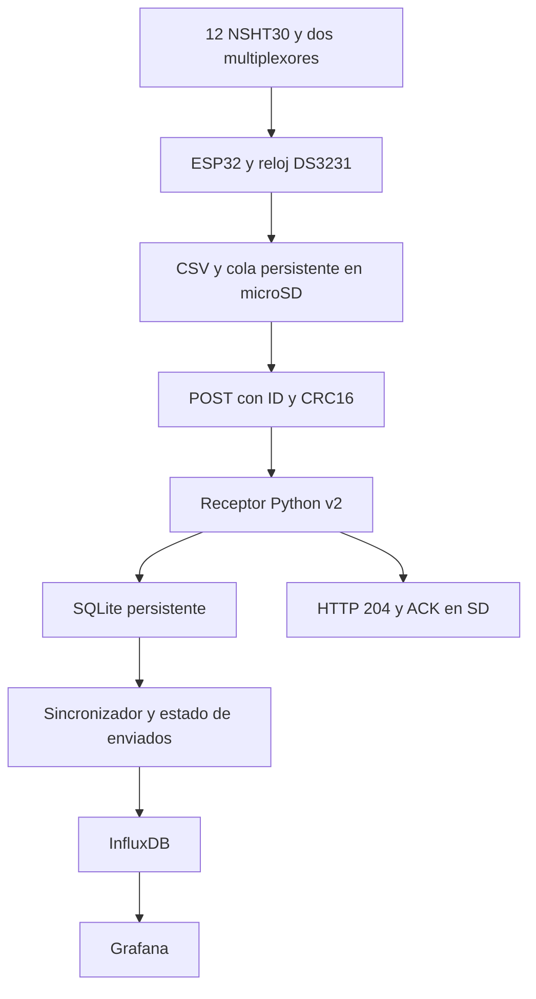

# Monitoreo higrotérmico SPC

Estado documental al **25/11/2026**. Dispositivo instalado para registrar temperatura y humedad relativa del aire en doce ubicaciones de placas experimentales del Instituto de Mecánica Aplicada. El montaje quedó adquiriendo localmente el 13/11 y se integró al servidor del laboratorio el 18/11. Las capturas muestran seguimiento de 48 horas. Tras el corte informado el 23/11, el dispositivo siguió adquiriendo y reanudó automáticamente el envío cuando el servidor volvió a estar disponible el 24/11.

## Funcionamiento

El receptor confirma **persistencia en SQLite**. El sincronizador confirma la publicación al recibir el 204 de InfluxDB. Un ID repetido con cuerpo idéntico devuelve 204 y conserva una fila SQLite; un conflicto devuelve 409 y un CRC16 incorrecto devuelve 422. Los fallos de entrega dejan el registro pendiente. La equivalencia completa de históricos requiere cotejar los registros del mismo intervalo.

## Archivos vigentes

- [Firmware de producción y configuración](firmware/SPC_JASON_PRODUCCION_10min_FINAL/README.md). Fuente FINAL del 18/11, confirmada por Leonardo el 23/11 como la instalada. Periodicidad de 10 minutos; log de eventos rotativo; offsets de temperatura desactivados. El código publicado coincide byte por byte con el archivo recibido.
- [Receptor, sincronizador y configuración de servidor](servidor/receptor-spc-v2/README.md). Los scripts recibidos y el repositorio coinciden en lógica; Leonardo confirmó que siguieron sin modificaciones durante la migración.
- [Guía de operación y traspaso a Fede](docs/operacion/guia-fede.md).
- [Instalación y configuración real](docs/INSTALACION_LABORATORIO_FINAL.md).
- [Arquitectura y límites](docs/arquitectura/arquitectura-sistema.md).
- [Registro de decisiones](docs/decisiones/decision-log.md).
- [Instalación, evidencias y corte eléctrico](docs/pruebas/puesta-en-servicio-2026-11-18.md).
- [Revisión del repositorio del 23/11](docs/auditoria-repositorio-2026-11-23.md).

## Montaje

| Elemento | Configuración |
| --- | --- |
| ESP32 DevKit | Adquisición y envío HTTP por Wi-Fi |
| Sensores y OLED | I²C SDA21 / SCL22, 100 kHz; NSHT30 0x44, OLED 0x3C |
| Multiplexores | Exterior 0x70; interior 0x71 |
| DS3231 | Segundo bus SDA17 / SCL16; hora local argentina; CR2032 y resistencia de carga retirada |
| microSD | SPI SCK14 / MISO27 / MOSI13 / CS26 |
| Alimentación | UPS de 5 V, regulador de 3,3 V y jumper que separa la alimentación del ESP32 de la placa durante el uso de USB |

| Ubicación | MUX | Canal |
| --- | --- | --- |
| AmbI | 0x71 | 0 |
| P0I | 0x71 | 1 |
| PcI | 0x71 | 2 |
| Y0I | 0x71 | 3 |
| Y3I | 0x71 | 4 |
| C0I | 0x71 | 5 |
| C4I | 0x71 | 6 |
| Y0E | 0x70 | 3 |
| Y3E | 0x70 | 4 |
| C0E | 0x70 | 5 |
| C4E | 0x70 | 6 |
| AmbE | 0x70 | 7 |

## Persistencia en microSD

| Archivo | Contenido |
| --- | --- |
| `spc_final.csv` | Hora local, ubicación, temperatura, HR y estado de cada lectura aceptada |
| `spc_final_cola.txt` | ID, tabulador y cuerpo Line Protocol con tiempo UTC en segundos |
| `spc_final_ack.txt` | Diario de avance confirmado con índice y complemento binario |
| `spc_eventos.csv` | Fecha y hora, evento, componente y detalle |
| `spc_eventos_1.csv`, `spc_eventos_2.csv` | Rotaciones del log de eventos, creadas cuando se alcanza el umbral |

El umbral del log es de **10 MiB por archivo** y conserva el activo y dos rotaciones. CSV, cola y ACK siguen creciendo. Un registro confirmado permanece en la cola; el ACK determina desde dónde se reanuda. Al reiniciar, una cola incompleta o inconsistente bloquea la adquisición para evitar sobrescribirla. Los eventos requieren RTC y SD disponibles.

## Servidor observado en producción

Receptor `receptor-spc-v2`, puerto publicado 8080; sincronizador `spc-sincronizador`; InfluxDB 2.7 y Grafana del laboratorio. La evidencia de migración muestra `INFLUX_URL=http://influxdb:8086`, organización `mi-org`, bucket `monitoreo-higrotermico` y red `iot_net`. Los Compose anteriores de notebook usan otros nombres y puertos. Consultar la guía antes de reconstruir servicios existentes.

## Verificaciones y próximas mejoras

- Banco documentado con CRC8, RTC, CSV, reenvío tras reinicio, CRC16 y deduplicación SQLite; 48 registros recuperados tras caída del receptor y 96 aceptados por InfluxDB después de otra interrupción.
- Montaje local del fin de semana del 13–16/11 y ciclo real con 12 ubicaciones en la migración del 18/11. Paneles posteriores de 24 y 48 horas.
- Caracterización en dos series de 501 ciclos con 15 sensores activos. Se conserva la limitación de referencia de HR en [su registro](docs/pruebas/caracterizacion-sht30-2026-11.md).
- La OLED mostró 4.452, 4.117 y 3.359 pendientes durante el reenvío. En Grafana, a las 16:40 del 24/11, las series del fin de semana se veían sin huecos. El [registro de producción](docs/pruebas/puesta-en-servicio-2026-11-18.md) documenta la recuperación observada.
- Quedan pendientes el cotejo registro por registro del corte, la medición de consumo/autonomía y la conciliación de los incidentes históricos de SD y S08.
- Propuestos ahorro energético, suspensión entre mediciones y reintentos espaciados durante caídas. Requieren ensayo en banco y coordinación de una interrupción del registro antes de reemplazar el firmware instalado.

Credenciales en `secrets.h` y archivos `.env` locales. El receptor usa HTTP sin TLS ni autenticación de dispositivo. Sus accesos deben mantenerse en la red autorizada del laboratorio.

El firmware de banco y el receptor anterior se conservan como antecedentes en sus carpetas originales.
