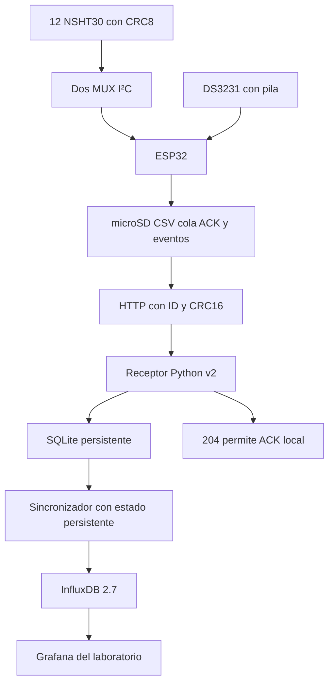

# Arquitectura del equipo instalado

Revisión del 23/11/2026. [Antecedente de cuatro sensores](../historico/arquitectura-cuatro-sensores-2026-10.md). La [puesta en servicio](../pruebas/puesta-en-servicio-2026-11-18.md) diferencia banco, instalación y operación observada.

## Adquisición y alimentación

El [README](../../README.md#montaje) contiene todos los pines y los doce canales por ubicación. Sensores y OLED comparten SDA21/SCL22 a 100 kHz; RTC tiene bus SDA17/SCL16; SD usa SPI. Alimentación de 5 V desde UPS con regulación de 3,3 V para periféricos. El jumper interrumpe la alimentación externa hacia el ESP32 durante el uso del USB. La ubicación física y el aislamiento de esa rama se verifican en la placa real según la [guía de Fede](../operacion/guia-fede.md).

El RTC contiene hora argentina. Los puntos LP usan tiempo UTC en segundos, con tres horas de conversión. El firmware sincroniza el reloj del ESP32 para marcas FAT desde el DS3231. Una ronda comparte timestamp y lee sucesivamente las ramas. La cadencia es primer ciclo al arrancar y después 10 min. Una lectura rechazada no genera fila válida del sensor.

## Persistencia

1. CSV se escribe antes de agregar ID y cuerpo a la cola. Un fallo parcial puede dejar diferencias entre CSV y cola; ambos se cotejan al diagnosticar un incidente.
2. ACK persistente indica la posición consecutiva confirmada. El arranque valida cola y ACK; una inconsistencia detiene adquisición. Una fila confirmada sigue presente en la cola.
3. Receptor verifica ID y CRC16-CCITT-FALSE sobre ID UTF-8, LF y cuerpo exacto. Guarda en SQLite con clave primaria y transacción antes de contestar 204. ID idéntico/cuerpo idéntico devuelve 204; cuerpo distinto 409; CRC inválido 422. El control de cuerpo comprueba UTF-8 y una línea; la validez semántica de LP se resuelve al publicar en InfluxDB.
4. Sincronizador consulta SQLite y su base de estado, transmite lotes y guarda IDs enviados tras el 204 de InfluxDB. El intervalo por defecto del script es 5 s y el lote 100. Sus valores efectivos se inspeccionan en el contenedor.
5. Un corte entre aceptación remota y avance local puede repetir una solicitud. SQLite resuelve duplicados por ID/cuerpo. InfluxDB identifica el punto por measurement, tags y timestamp; repetir los mismos campos y valores mantiene ese punto. La conciliación completa se hace sobre el mismo intervalo e identidad.

## Eventos y consumo

El firmware FINAL tiene `spc_eventos.csv` y dos rotaciones a partir de 10 MiB. Los eventos requieren SD y RTC; registran arranque, transiciones Wi-Fi/HTTP/sensor y cola vacía cuando corresponde. Algunos errores de SD se observan solo por monitor serie. Retención/compactación de CSV, cola y ACK quedan para mantenimiento.

Reintento nominal tras fallo 10 s, pausa entre entregas exitosas 100 ms y timeout HTTP 2 s, además del tiempo de operación. Adquisición tiene prioridad. Suspensión y reintentos de varios minutos durante una caída siguen propuestos, con ensayo antes de instalar. Dormir el ESP32 no desconecta por sí mismo periféricos externos.

## Configuración de servidor

Red de laboratorio `iot_net`, InfluxDB accesible como `http://influxdb:8086`, organización `mi-org`, bucket `monitoreo-higrotermico`, receptor publicado en 8080. La fuente y el estado de sincronización son dos bases SQLite diferentes. Credenciales se conservan localmente. Cada restauración debe mantener coherencia entre las dos bases y el destino InfluxDB. Receptor HTTP sin autenticación de cliente ni TLS, limitado al ámbito de red autorizado.
